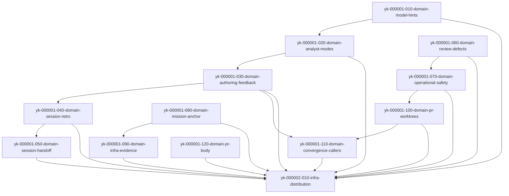
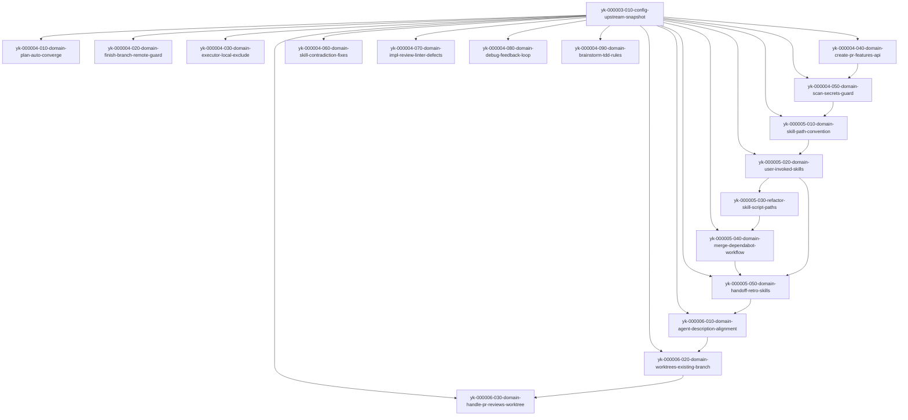

**Next PHASE (yk): `000007`** — authoritative starting point for the next `yk`-initials `ywc-task-generator` batch. Read this line first; do not re-derive by scanning when it is present. After allocating a new batch, update this line to `highest allocated PHASE + 1`.
**Next PHASE (yw): `000005`** — authoritative starting point for the next `yw`-initials `ywc-task-generator` batch. Read this line first; do not re-derive by scanning when it is present. After allocating a new batch, update this line to `highest allocated PHASE + 1`.

# Codex Issue 69 — task dependency graph

Source: `docs/ywc-plans/20261105-codex-issue69-upstream-adoption.md`. Mode: llm; language: en; initials: yk.

## Phase yk-000001 — Source contracts and focused evaluations

- `yk-000001-010-domain-model-hints` → (root)
- `yk-000001-020-domain-analyst-modes` → depends on `yk-000001-010-domain-model-hints`
- `yk-000001-030-domain-authoring-feedback` → depends on `yk-000001-020-domain-analyst-modes`
- `yk-000001-040-domain-session-retro` → depends on `yk-000001-030-domain-authoring-feedback`
- `yk-000001-050-domain-session-handoff` → depends on `yk-000001-040-domain-session-retro`
- `yk-000001-060-domain-review-defects` → (root)
- `yk-000001-070-domain-operational-safety` → depends on `yk-000001-060-domain-review-defects`
- `yk-000001-080-domain-mission-anchor` → (root)
- `yk-000001-090-domain-infra-evidence` → depends on `yk-000001-080-domain-mission-anchor`
- `yk-000001-100-domain-pr-worktrees` → depends on `yk-000001-070-domain-operational-safety`
- `yk-000001-110-domain-convergence-callers` → depends on `yk-000001-030-domain-authoring-feedback`, `yk-000001-100-domain-pr-worktrees`
- `yk-000001-120-domain-pr-body` → (root)

## Phase yk-000002 — Distribution integration

- `yk-000002-010-infra-distribution` → depends on `yk-000001-010-domain-model-hints`, `yk-000001-020-domain-analyst-modes`, `yk-000001-030-domain-authoring-feedback`, `yk-000001-040-domain-session-retro`, `yk-000001-050-domain-session-handoff`, `yk-000001-060-domain-review-defects`, `yk-000001-070-domain-operational-safety`, `yk-000001-080-domain-mission-anchor`, `yk-000001-090-domain-infra-evidence`, `yk-000001-100-domain-pr-worktrees`, `yk-000001-110-domain-convergence-callers`, `yk-000001-120-domain-pr-body`

## Phase yk-000003 — Claude Code Issue 69 — upstream snapshot

- `yk-000003-010-config-upstream-snapshot` → (root)

## Phase yk-000004 — Claude Code Issue 69 — single-skill ports (Phase A)

- `yk-000004-010-domain-plan-auto-converge` → depends on `yk-000003-010-config-upstream-snapshot`
- `yk-000004-020-domain-finish-branch-remote-guard` → depends on `yk-000003-010-config-upstream-snapshot`
- `yk-000004-030-domain-executor-local-exclude` → depends on `yk-000003-010-config-upstream-snapshot`
- `yk-000004-040-domain-create-pr-features-api` → depends on `yk-000003-010-config-upstream-snapshot`
- `yk-000004-050-domain-scan-secrets-guard` → depends on `yk-000003-010-config-upstream-snapshot`, `yk-000004-040-domain-create-pr-features-api`
- `yk-000004-060-domain-skill-contradiction-fixes` → depends on `yk-000003-010-config-upstream-snapshot`
- `yk-000004-070-domain-impl-review-linter-defects` → depends on `yk-000003-010-config-upstream-snapshot`
- `yk-000004-080-domain-debug-feedback-loop` → depends on `yk-000003-010-config-upstream-snapshot`
- `yk-000004-090-domain-brainstorm-tdd-rules` → depends on `yk-000003-010-config-upstream-snapshot`

## Phase yk-000005 — Claude Code Issue 69 — cross-cutting conventions (Phase B)

- `yk-000005-010-domain-skill-path-convention` → depends on `yk-000003-010-config-upstream-snapshot`, `yk-000004-050-domain-scan-secrets-guard`
- `yk-000005-020-domain-user-invoked-skills` → depends on `yk-000003-010-config-upstream-snapshot`, `yk-000005-010-domain-skill-path-convention`
- `yk-000005-030-refactor-skill-script-paths` → depends on `yk-000005-020-domain-user-invoked-skills`
- `yk-000005-040-domain-merge-dependabot-workflow` → depends on `yk-000003-010-config-upstream-snapshot`, `yk-000005-030-refactor-skill-script-paths`
- `yk-000005-050-domain-handoff-retro-skills` → depends on `yk-000003-010-config-upstream-snapshot`, `yk-000005-040-domain-merge-dependabot-workflow`, `yk-000005-020-domain-user-invoked-skills`

## Phase yk-000006 — Claude Code Issue 69 — agents and worktrees (Phase C)

- `yk-000006-010-domain-agent-description-alignment` → depends on `yk-000003-010-config-upstream-snapshot`, `yk-000005-050-domain-handoff-retro-skills`
- `yk-000006-020-domain-worktrees-existing-branch` → depends on `yk-000003-010-config-upstream-snapshot`, `yk-000006-010-domain-agent-description-alignment`
- `yk-000006-030-domain-handle-pr-reviews-worktree` → depends on `yk-000003-010-config-upstream-snapshot`, `yk-000006-020-domain-worktrees-existing-branch`

## Task Summary

| Task ID | Title | Model Hint |
|---|---|---|
| yk-000001-010-domain-model-hints | Model hint metadata | standard |
| yk-000001-020-domain-analyst-modes | Analyst caller and mode contract | advanced |
| yk-000001-030-domain-authoring-feedback | Authoring feedback loops | standard |
| yk-000001-040-domain-session-retro | Evidence bounded retrospective | standard |
| yk-000001-050-domain-session-handoff | Safe session handoff | advanced |
| yk-000001-060-domain-review-defects | Review defects and targeted linters | standard |
| yk-000001-070-domain-operational-safety | Delivery and isolation safety | advanced |
| yk-000001-080-domain-mission-anchor | Durable mission anchor | advanced |
| yk-000001-090-domain-infra-evidence | Applied scope and bounded FinOps | advanced |
| yk-000001-100-domain-pr-worktrees | PR worktree identity and preservation | advanced |
| yk-000001-110-domain-convergence-callers | Single owner spec convergence | advanced |
| yk-000001-120-domain-pr-body | Feature oriented PR body | standard |
| yk-000002-010-infra-distribution | Bundle distribution integration | standard |
| yk-000003-010-config-upstream-snapshot | T0 (Phase 0) | sonnet |
| yk-000004-010-domain-plan-auto-converge | A1 (#371) | opus |
| yk-000004-020-domain-finish-branch-remote-guard | A3 (#346) | opus |
| yk-000004-030-domain-executor-local-exclude | A8 (executors) | sonnet |
| yk-000004-040-domain-create-pr-features-api | A5 (#391) | sonnet |
| yk-000004-050-domain-scan-secrets-guard | A8 (scan-secrets) | opus |
| yk-000004-060-domain-skill-contradiction-fixes | A2 (#337) + A8 (small fixes) | sonnet |
| yk-000004-070-domain-impl-review-linter-defects | A4 (#340) | sonnet |
| yk-000004-080-domain-debug-feedback-loop | A6 (#335) | sonnet |
| yk-000004-090-domain-brainstorm-tdd-rules | A7 (#335, #345) | sonnet |
| yk-000005-010-domain-skill-path-convention | B1 (#345) | sonnet |
| yk-000005-020-domain-user-invoked-skills | B3 (#335, #345) | sonnet |
| yk-000005-030-refactor-skill-script-paths | B2 (#345) | sonnet |
| yk-000005-040-domain-merge-dependabot-workflow | B4 (#341, #345) | opus |
| yk-000005-050-domain-handoff-retro-skills | B5 (#335, #341, #345) | opus |
| yk-000006-010-domain-agent-description-alignment | C1 (#345) | sonnet |
| yk-000006-020-domain-worktrees-existing-branch | C2 (#347) | sonnet |
| yk-000006-030-domain-handle-pr-reviews-worktree | C3 (#347) | opus |

## Parallel Execution Notes

Root-ready tasks: model hints, review defects, mission anchor and PR body. PR worktrees depends on operational safety because it extends the behavior runner introduced there. Other edges follow the specification feature dependencies. Conflicts are edit scheduling restrictions, not extra functional dependencies; serialize overlapping agent evals, cross-skill graph and behavior runner changes. No task may run alongside an explicitly conflicting task. Phase 2 begins only after every Phase 1 task is merged, because counts, catalogs and generated plugin copies require all completed source contracts. Analyzer waves are dependency candidates only.

### Claude Code Issue 69 port (plan: `docs/ywc-plans/20261105-claude-upstream-issue-69-port.md`)

Mode: llm; language: en; initials: yk (phases `yk-000003`–`yk-000006`). This batch is independent of the Codex batch above (`yk-000001`/`yk-000002`); the only shared surface is the root skill/agent counts (see conflict below).

Phase gates: `yk-000003` (snapshot) gates everything. Phase `yk-000004` (A) tasks are mutually parallel except `yk-000004-050` after `yk-000004-040` (both edit `ywc-create-pr/SKILL.md`). Phase `yk-000005` (B) is a strict chain B1 → B3 → B2 → B4 → B5 because of shared files (`claude-code/skills/CLAUDE.md`, `ywc-skill-author/SKILL.md`, `history.mechanical.json`, `scripts/validate.sh`). Phase `yk-000006` (C) is a chain C1 → C2 → C3.

Spec inconsistency resolved: FR5's `claude-code/skills/CLAUDE.md` row lists B2 before B3, while the global order and the `ywc-skill-author/SKILL.md` row list B3 before B2. The global order (B1 → B3 → B2 → B4 → B5) is used.

Conflict with the Codex batch: `yk-000005-050-domain-handoff-retro-skills` and `yk-000002-010-infra-distribution` both edit root `CLAUDE.md` / `README*.md` counts; do not run them concurrently. Because both batches share the `yk` namespace, an executor that treats `yk-000002` as a hard gate for `yk-000003` will wait for the Codex distribution task; that ordering is not a functional dependency.

`history.mechanical.json`: Phase A tasks run `score.py --ci` but restore the file so parallel merges do not conflict; Phase B/C tasks commit the auto-updated file.

Inferred criticality: `yk-000004-010-domain-plan-auto-converge` is `critical` only by the keyword heuristic (Ownership contains `ywc-auth-implement`); downgrade to `normal` if desired. `yk-000006-020-domain-worktrees-existing-branch` is `normal` per the spec's Critical Surfaces but defines the branch-name validation C3 relies on.

## Spec Coverage

- FR-1 / AC-1: `yk-000001-010-domain-model-hints` owns advisory tier/rationale and matching preview/summary; `test.md` provides clause-level expected outcomes.
- FR-2 / AC-2: `yk-000001-020-domain-analyst-modes` owns three caller/mode pairs and bounded diagnostic feedback; `test.md` provides clause-level expected outcomes.
- FR-3 / AC-3: `yk-000001-030-domain-authoring-feedback` owns repository-first questions, behavior TDD and Writing Levers; `test.md` provides clause-level expected outcomes.
- FR-4 / AC-4: `yk-000001-040-domain-session-retro` owns retro categories, ranking, evidence and owner rules; `test.md` provides clause-level expected outcomes.
- FR-4 / AC-4: `yk-000001-050-domain-session-handoff` owns handoff sections, safe artifact writes and invocation metadata; `test.md` provides clause-level expected outcomes.
- FR-5 / AC-5: `yk-000001-060-domain-review-defects` owns A-005–007 and installed targeted-linter evidence; `test.md` provides clause-level expected outcomes.
- FR-6 / AC-6: `yk-000001-070-domain-operational-safety` owns remote deletion, isolation setup, polling deadline and severity row guards; `test.md` provides clause-level expected outcomes.
- FR-7 / AC-7: `yk-000001-080-domain-mission-anchor` owns read/update/curate mission with stable NG/CN history; `test.md` provides clause-level expected outcomes.
- FR-8 / AC-8: `yk-000001-090-domain-infra-evidence` owns eligible applied scope and bounded inline FinOps evidence; `test.md` provides clause-level expected outcomes.
- FR-9 / AC-9: `yk-000001-100-domain-pr-worktrees` owns existing-branch producer and pinned PR worktree consumer; `test.md` provides clause-level expected outcomes.
- FR-10 / AC-10: `yk-000001-110-domain-convergence-callers` owns single-owner convergence and artifact-profile preservation; `test.md` provides clause-level expected outcomes.
- FR-10 / AC-10: `yk-000001-120-domain-pr-body` owns feature Changes and conditional API table; `test.md` provides clause-level expected outcomes.
- FR-10 / AC-10: `yk-000002-010-infra-distribution` owns catalog counts/locales, generated plugin and temporary installs; `test.md` provides clause-level expected outcomes.

Failure Modes: provenance/locale gaps → every source task + distribution; analyst mismatch → analyst; absent session/mission bundles → retro/handoff/mission + distribution; read-only artifact writes → retro/infra; transport/cwd failure → worktrees/operational safety; unavailable runtime → every evidence section; recursive convergence → convergence; auth/schema-only route changes → PR body.

### Claude Code Issue 69 port coverage

- AC0 → `yk-000003-010`; AC1/AC2/AC2b/AC2c, FR6, FR7 → `yk-000004-010`; AC4 → `yk-000004-020`; AC9, NFR1 → `yk-000004-030`; AC6 → `yk-000004-040`; AC8 → `yk-000004-050`; AC3, AC8b → `yk-000004-060`; AC5 → `yk-000004-070`; AC7 → `yk-000004-080`; AC7b → `yk-000004-090`.
- AC11b → `yk-000005-010`; AC12 (2 skills), AC13, FR8 → `yk-000005-020`; AC10, AC11 → `yk-000005-030`; AC13b → `yk-000005-040`; AC12 (4 skills), AC14, AC14b, AC14c → `yk-000005-050`; AC15 → `yk-000006-010`; AC16 → `yk-000006-020`; AC16b, AC17 → `yk-000006-030`.
- FR1–FR4 apply to every task; FR5 is the graph above; the NFR1 body-line check is in every task that edits a `SKILL.md`; NFR2 follows from B3/B5.
- Failure Modes: `${CLAUDE_SKILL_DIR}` / partial install → B1; user-invoked → B3; malicious branch / PR number / fork PR → C2, C3; recursion / double run / non-DONE → A1; handoff secret → B5; remote deletion → A3; CI red → B3; upstream unavailable → T0; required-check gate → B4.

## Open Questions

No unjustified requirements emitted. Live runtime availability remains an execution-time limitation, not a source-contract success claim. No DB migration or library introduction is required.

Claude Code Issue 69 port: no requirement was dropped for lacking an Acceptance Criterion. Items verified by review only (no grep AC): brainstorm ordering rules and tdd seam line (`yk-000004-090`), fix #4 / checklist alignment (`yk-000004-080`), refactor-clean and security-audit sentence corrections (`yk-000004-060`), advisor-escalation / aggregate-pr / worktree-run corrections (`yk-000004-030`). The spec's Open Questions 1–6 keep their stated defaults.

## Visual Dependency Graph

### Claude Code Issue 69 port

